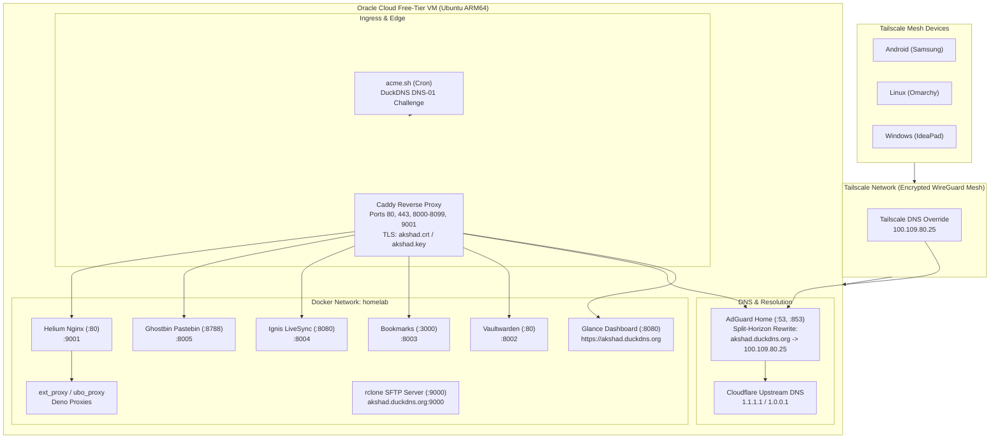

# homelab time!

*(I use Glance btw)*


Oracle free tier ARM VM doing way more than Oracle intended. Everything runs inside a Tailscale mesh so nothing is publicly exposed. Clean URLs via DuckDNS + AdGuard DNS rewrite. One cert, one reverse proxy (Caddy).

---

## What's Running

| URL                               | Service      | Container / Image             | What it does                             |
| --------------------------------- | ------------ | ----------------------------- | ---------------------------------------- |
| `https://akshad.duckdns.org`      | Glance       | `glanceapp/glance`            | Dashboard, first thing I open            |
| `https://akshad.duckdns.org:8001` | AdGuard Home | `adguard/adguardhome`         | DNS + ad blocking                        |
| `https://akshad.duckdns.org:8002` | Vaultwarden  | `vaultwarden/server:latest`   | Passwords & 2FA                          |
| `https://akshad.duckdns.org:8003` | Bookmarks    | `akshad135/bookmarks:latest`  | Personal link shelf                      |
| `https://akshad.duckdns.org:8004` | Ignis        | `nobbe/ignis:latest`          | Obsidian LiveSync backend                |
| `https://akshad.duckdns.org:8005` | Pastebin     | `akshad135/ghostbin:latest`   | Self-hosted Ghostbin pastebin            |
| `https://akshad.duckdns.org:8006` | Sure         | `sure-web` (planned/optional) | Personal finance tracker                 |
| `akshad.duckdns.org:9000`         | rclone SFTP  | `rclone/rclone:latest`        | Windows <-> Oracle <-> android file sync |
| `https://akshad.duckdns.org:9001` | Helium       | `helium-services-*`           | Self-hosted browser extension backend    |

Port convention: `8xxx` = web UIs through Caddy, `9xxx` = backend/non-browser stuff.

---

## How It All Fits Together

Everything is on a Tailscale mesh. AdGuard rewrites `akshad.duckdns.org` to the Oracle Tailscale IP so traffic never hits the public internet. Caddy sits in front of everything with one ACME cert that works across all ports (TLS validates the hostname, not the port).



See [`docs/architecture.md`](docs/architecture.md) for the full picture.

---

## Repo Layout

```
homelab/
├── caddy/          the thing that runs in front of everything
├── services/       one folder per service (compose, configs, env examples)
├── docs/           how things work and why
├── scripts/        cron jobs and backup utilities
└── diagrams/       architecture, routing, DNS, and cert flow diagrams
```

Each service folder has a compose file, and whatever extra config it needs.

---

## If I Ever Have to Rebuild This

1. Create the Docker network: `docker network create homelab`
2. Start AdGuard first — everything needs DNS
3. Set Tailscale override DNS to the Oracle Tailscale IP (`100.109.80.25`)
4. Add the AdGuard DNS rewrite: `akshad.duckdns.org → 100.109.80.25`
5. Issue the ACME cert (see [`docs/ssl.md`](docs/ssl.md))
6. Start Caddy
7. Start everything else in any order
8. Restore crontab from `scripts/crontab.txt`

---

## Docs

- [Architecture](docs/architecture.md)
- [Networking & DNS](docs/networking.md)
- [SSL](docs/ssl.md)
- [Ports](docs/ports.md)
- [Backups](docs/backups.md)
- [Troubleshooting](docs/troubleshooting.md)
