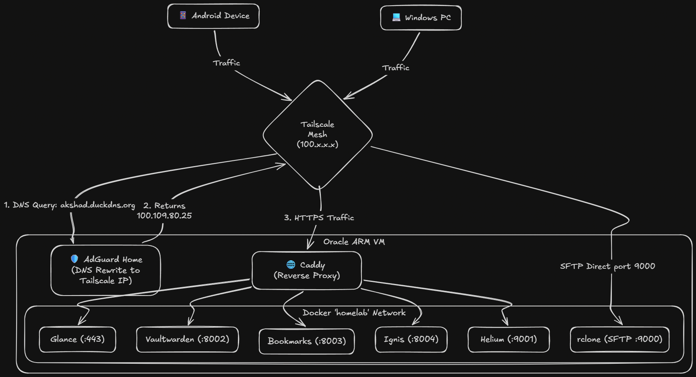
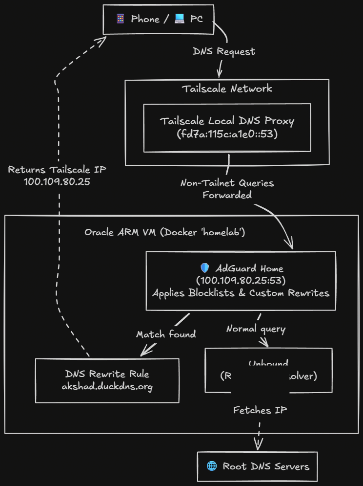
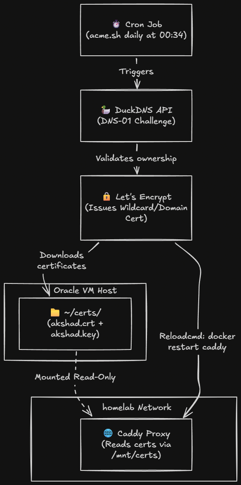

# Architecture

Oracle ARM VM, Tailscale mesh, Caddy as the only entry point. That's basically it.

---

## The Big Picture



All of these run on a Docker bridge network called `homelab`. Caddy reaches them by container name (e.g. `vaultwarden:80`). No service publishes its own host port — only Caddy does.

---

## DNS Flow



---

## Cert Flow



One cert works on every port because TLS validates the hostname, not the port number.

---

## Docker Network

Single external bridge called `homelab`. Created once on the host:

```bash
docker network create homelab
```

Every compose file references it as external. This is how Caddy can do `reverse_proxy vaultwarden:80` and Docker resolves the name. Glance health checks also run over this network directly (`http://adguardhome`, not the public URL through Caddy).

---

## Oracle VM

One ARM VM, always-free tier. 4 OCPUs, 24GB RAM, 200GB storage. Oracle's firewall only allows SSH (22) and Tailscale (41641/UDP). Everything else is Tailscale-only.

---

## Diagrams

See [`../diagrams/`](../diagrams/).
