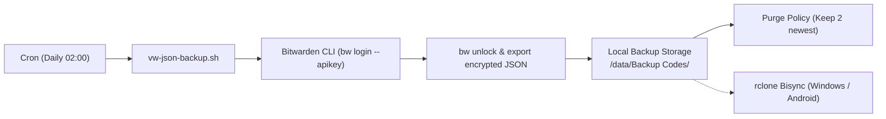

# Backups

## Vaultwarden (Daily JSON Export)

A cron job runs every night at 2:00 AM and exports the vault to encrypted JSON using the Bitwarden CLI. It retains the 2 most recent backups.

- Script: [`../scripts/vw-json-backup.sh`](../scripts/vw-json-backup.sh)
- Cron: `0 2 * * * /home/ubuntu/vw-json-backup.sh > /dev/null 2>&1`

To restore: Vaultwarden Web UI -> Tools -> Import Data -> Bitwarden (JSON).

---

## Documents (rclone Bisync)

Windows <-> Oracle <-> Android file sync via rclone SFTP on port `9000`. Runs on demand or via task scheduler across devices.

---

## AdGuard Config

`AdGuardHome.yaml` contains blocklists, DNS rewrites, and settings. Backed up manually upon major changes.
