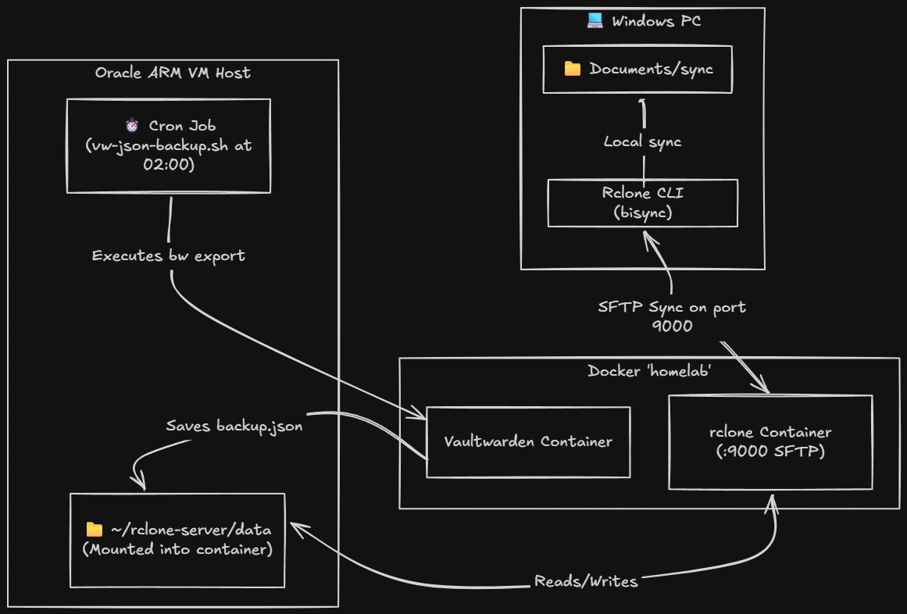

# Backups



## Vaultwarden (Daily JSON Export)

A cron job runs every night at 2am and exports the vault to JSON using the Bitwarden CLI. Keeps the last 7 exports.

Script: [`../scripts/vw-json-backup.sh`](../scripts/vw-json-backup.sh)
Cron: `0 2 * * * /home/ubuntu/vw-json-backup.sh`

To restore: Vaultwarden web UI -> Tools -> Import -> Bitwarden (JSON)

---

## Documents (rclone Bisync)

Windows <-> Oracle <-> Android sync via rclone SFTP on port 9000. Runs on demand from Windows and Android. Bidirectional, so changes from either side show up on the other.

---

## AdGuard Config

`AdGuardHome.yaml` has the blocklists, DNS rewrites, and credentials. Doesn't change often so manual backup when it does is fine:

```bash
cp -r ~/adguard-home/conf ~/backups/adguard-$(date +%Y%m%d)
```

---

## This Repo

Compose files, Caddyfile, and docs are all here. Committing changes here is the backup for "how to rebuild the whole thing."

---
