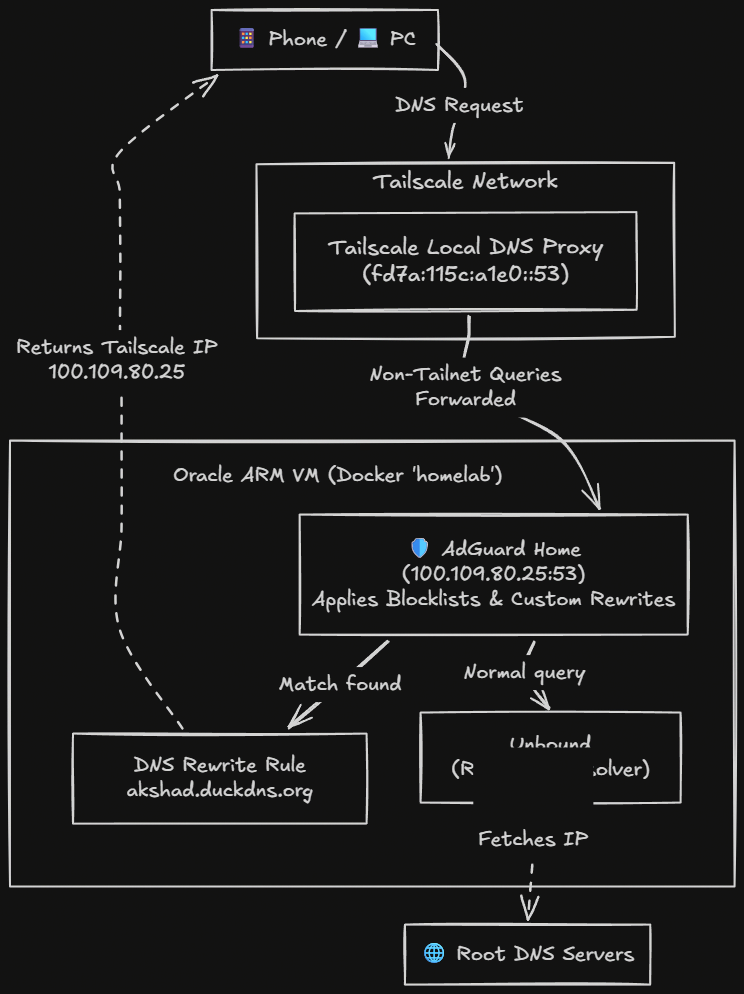

# Networking & DNS

Wasted 10hrs on 2nd July which motivated me to make this repo 🥲

---

## Tailscale

Tailscale connects Oracle, Windows, and Android in a mesh. Oracle acts as the exit node.

Key setting in Tailscale admin:

- **Override DNS** → `100.109.80.25` (Oracle Tailscale IP)

This makes every device on the tailnet send DNS queries to AdGuard on the Oracle VM. MagicDNS is still on so `*.ts.net` names resolve, but none of the services use them anymore.

---

## The DNS Rewrite

DuckDNS points `akshad.duckdns.org` to Oracle's public IP. But Oracle's public IP has no open ports except SSH. So inside AdGuard we override it:



Every device using AdGuard (all of them, via Tailscale override DNS) now resolves the domain to the Tailscale IP. Traffic goes through the mesh, not the public internet. This is split-horizon DNS — sounds fancy, it's literally one entry in AdGuard's DNS Rewrites page.

---

## AdGuard + Unbound

AdGuard handles:

- Blocking ads and trackers via community lists
- The DuckDNS rewrite
- Forwarding everything else to Unbound

Unbound handles:

- Recursive resolution — queries root servers directly instead of forwarding to Cloudflare/Google
- Runs as a sidecar container in the same AdGuard compose stack

---

## Docker Networking

All containers share a bridge network called `homelab`. This is how Caddy finds services:

```
reverse_proxy vaultwarden:80
              ^-- Docker resolves this to the container IP
```

Containers that don't need direct host access have no published ports at all. Glance health checks run over this internal network too — `http://adguardhome` instead of going out through Caddy.

Things that do publish host ports:

- **Caddy** — web entry point, needs to be reachable
- **AdGuard** — DNS (53) and DoT (853) are native protocols, can't go through a reverse proxy
- **rclone** — SFTP is a binary protocol, Caddy can't proxy it

---

## rclone SFTP

Windows connects directly to the Oracle Tailscale IP on port 9000, bypassing Caddy:

```ini
[oracle-sftp]
type = sftp
host = 100.109.80.25
port = 9000
user = akshad
```

Sync command:

```bat
rclone bisync "oracle-sftp:/" "C:\Users\akshad\Documents\sync" --create-empty-src-dirs -v
```
