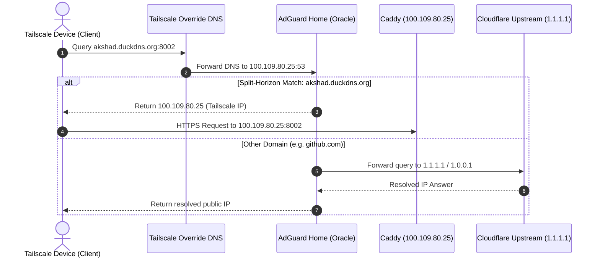

# Networking & DNS

---

## Tailscale

Tailscale connects Oracle, Linux, Windows, and Android in an encrypted mesh. Oracle acts as the exit node and central homelab host.

Key setting in Tailscale admin:

- **Override DNS** → `100.109.80.25` (Oracle Tailscale IP)

This routes every device on the tailnet to send DNS queries to AdGuard Home on the Oracle VM. MagicDNS is preserved so `*.ts.net` names resolve, while our homelab services use `akshad.duckdns.org`.

---

## The DNS Rewrite (Split-Horizon)

DuckDNS points `akshad.duckdns.org` to Oracle's public IP. But Oracle's public IP has no open web ports. Inside AdGuard, we rewrite the domain to the Tailscale IP:

```
akshad.duckdns.org → 100.109.80.25
```

Every device using AdGuard resolves the domain directly to the Tailscale IP. Traffic routes through the WireGuard mesh, never traversing the public internet.



---

## AdGuard Upstream (Cloudflare 1.1.1.1)

AdGuard acts as the DNS ad-blocker and DNS rewrite engine. For recursive resolving of internet queries, AdGuard forwards upstream requests directly to Cloudflare DNS (`1.1.1.1` and `1.0.0.1`).
