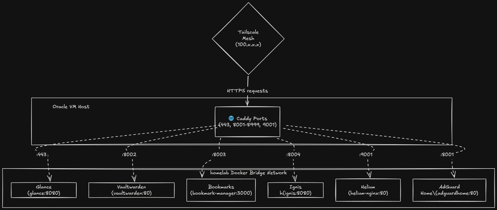

# Ports

## Convention

| Range | Purpose |
|-------|---------|
| `443` | Default HTTPS (homepage) |
| `8000-8999` | Web UIs through Caddy |
| `9000-9999` | Backend / non-HTTP services |
| `53`, `853` | Native DNS protocols |
| `22` | SSH |

Caddy already exposes the full `8000-8999` range, so adding a new web UI only requires a new block in the Caddyfile — no compose changes.

---

## Current Assignments



## Internal Only (No Host Port)

These are on the `homelab` Docker network but not published to the host:

`adguardhome:80`, `vaultwarden:80`, `glance:8080`, `bookmark-manager:3000`, `ignis:8080`, `sure-web:3000`, `unbound:5335`, `helium-nginx:80`, `ext_proxy`, `ubo_proxy`

---

## Next Available Slots

```
8007, 8008, 8009 ...   web UIs
9002, 9003 ...         backend stuff
```

