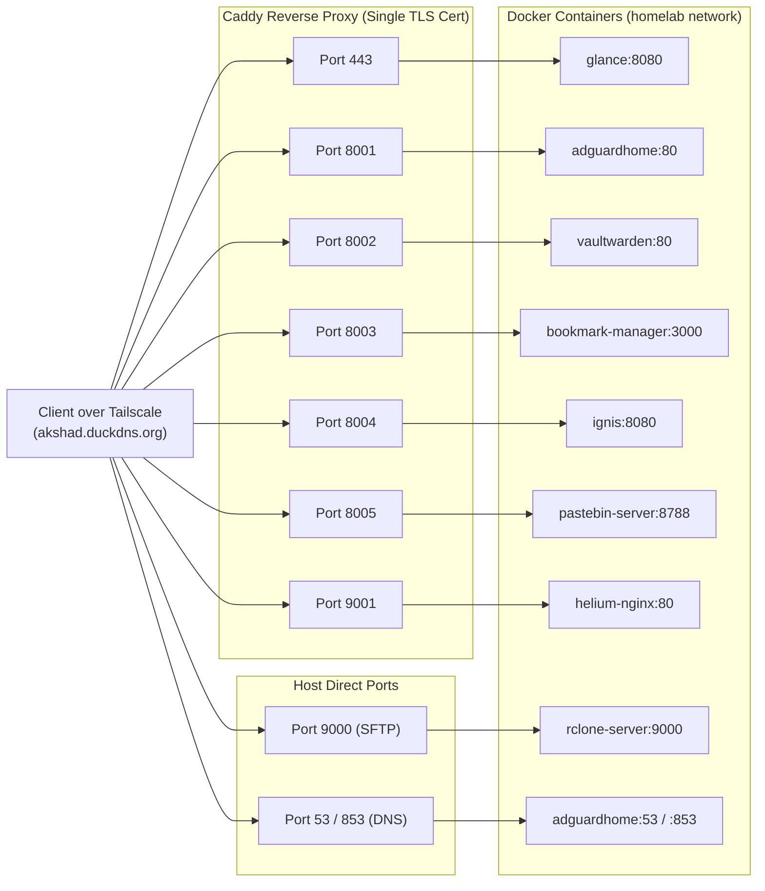

# Ports

## Convention

| Range | Purpose |
|-------|---------|
| `443` | Default HTTPS (homepage / Glance) |
| `8000-8999` | Web UIs through Caddy |
| `9000-9999` | Backend / non-HTTP services |
| `53`, `853` | Native DNS protocols (AdGuard) |
| `22` | SSH |

Caddy already exposes the full `8000-8999` range, so adding a new web UI only requires a new block in the Caddyfile — no compose changes.

---

## Current Assignments

| Port | Service | Internal Backend | Protocol | Description |
|------|---------|------------------|----------|-------------|
| `443` | Glance | `glance:8080` | HTTPS (Caddy) | Main dashboard |
| `8001` | AdGuard Home | `adguardhome:80` | HTTPS (Caddy) | AdGuard Web UI |
| `8002` | Vaultwarden | `vaultwarden:80` | HTTPS (Caddy) | Password manager |
| `8003` | Bookmarks | `bookmark-manager:3000` | HTTPS (Caddy) | Personal link shelf |
| `8004` | Ignis | `ignis:8080` | HTTPS (Caddy) | Obsidian LiveSync |
| `8005` | Pastebin | `pastebin-server:8788` | HTTPS (Caddy) | Ghostbin paste service |
| `8006` | Sure | `sure-web:3000` | HTTPS (Caddy) | Personal finance (optional/planned) |
| `9000` | rclone | `rclone-server:9000` | SFTP (Direct Host Port) | File sync backend |
| `9001` | Helium | `helium-nginx:80` | HTTPS (Caddy) | Browser extension backend |
| `53` | DNS | `adguardhome:53` | TCP/UDP (Direct Host Port) | Standard DNS |
| `853` | DoT | `adguardhome:853` | TCP (Direct Host Port) | DNS-over-TLS |



---

## Internal Only (No Host Port)

These run strictly on the `homelab` Docker network and are not published directly to the host:

- `adguardhome:80`
- `vaultwarden:80`
- `glance:8080`
- `bookmark-manager:3000`
- `ignis:8080`
- `pastebin-server:8788`
- `sure-web:3000`
- `unbound:5335`
- `helium-nginx:80`
- `ext_proxy`, `ubo_proxy`, `ext_proxy_backup`

---

## Next Available Slots

```
8007, 8008, 8009 ...   web UIs
9002, 9003 ...         backend services
```
