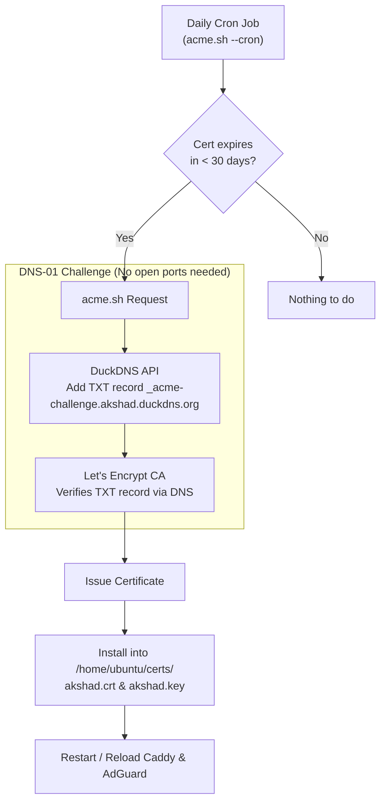

# SSL

One cert, works everywhere, renews itself.

---

## How It Works

`acme.sh` issues a wildcard/SAN cert for `akshad.duckdns.org` from Let's Encrypt using the DNS-01 challenge via DuckDNS API. No open port or public web server is required.

The certificate is saved to `/home/ubuntu/certs/` (`akshad.crt` and `akshad.key`) on the Oracle VM. Caddy mounts this folder read-only and applies this certificate to every HTTPS endpoint (`443`, `8001`, `8002`, `8003`, `8004`, `8005`, `8006`, `9001`).



---

## Initial Setup (When Rebuilding)

```bash
# Issue the cert
export DuckDNS_Token="your-token-here"
acme.sh --issue --dns dns_duckdns -d akshad.duckdns.org

# Install to the certs dir, trigger Caddy restart on renewal
acme.sh --install-cert -d akshad.duckdns.org \
  --cert-file /home/ubuntu/certs/akshad.crt \
  --key-file  /home/ubuntu/certs/akshad.key \
  --reloadcmd "docker restart caddy"
```
