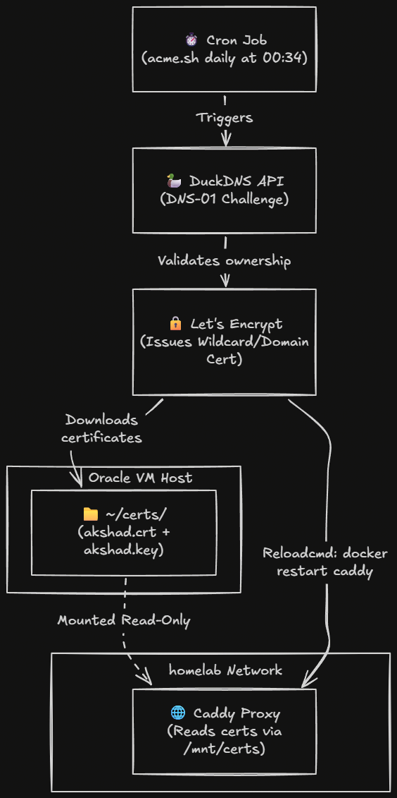

# SSL

One cert, works everywhere, renews itself.

---

## How It Works



`acme.sh` issues a cert for `akshad.duckdns.org` from Let's Encrypt using DNS-01 challenge — it uses the DuckDNS API to prove domain ownership, so no web server or open port is needed.

The cert lives at `~/adguard-certs/akshad.crt` and `akshad.key` on the Oracle VM. Caddy mounts that directory read-only and uses the same cert for every service — port 443, 8001, 8002, all of them. TLS validates the hostname, not the port, so one cert covers everything.

---

## Initial Setup (When Rebuilding)

```bash
# Issue the cert
export DuckDNS_Token="your-token-here"
acme.sh --issue --dns dns_duckdns -d akshad.duckdns.org

# Install to the certs dir, trigger Caddy restart on renewal
acme.sh --install-cert -d akshad.duckdns.org \
  --cert-file   ~/adguard-certs/akshad.crt \
  --key-file    ~/adguard-certs/akshad.key \
  --reloadcmd   "docker restart caddy"
```

acme.sh saves the DuckDNS token after the first run so you don't need to export it again.

---

## Auto-Renewal

acme.sh installs its own cron during setup:

```
34 0 * * * ~/.acme.sh/acme.sh --cron --home ~/.acme.sh > /dev/null
```

Runs daily, only actually renews when the cert is within 30 days of expiry (~60 days after issue). After renewal it runs `docker restart caddy` which picks up the new files.

---

## Useful Commands

```bash
# Check when the cert expires
openssl x509 -in ~/adguard-certs/akshad.crt -noout -dates

# Force renew right now
acme.sh --renew -d akshad.duckdns.org --force

# Verify what Caddy is actually serving
openssl s_client -connect akshad.duckdns.org:443 -servername akshad.duckdns.org 2>/dev/null \
  | openssl x509 -noout -dates
```
