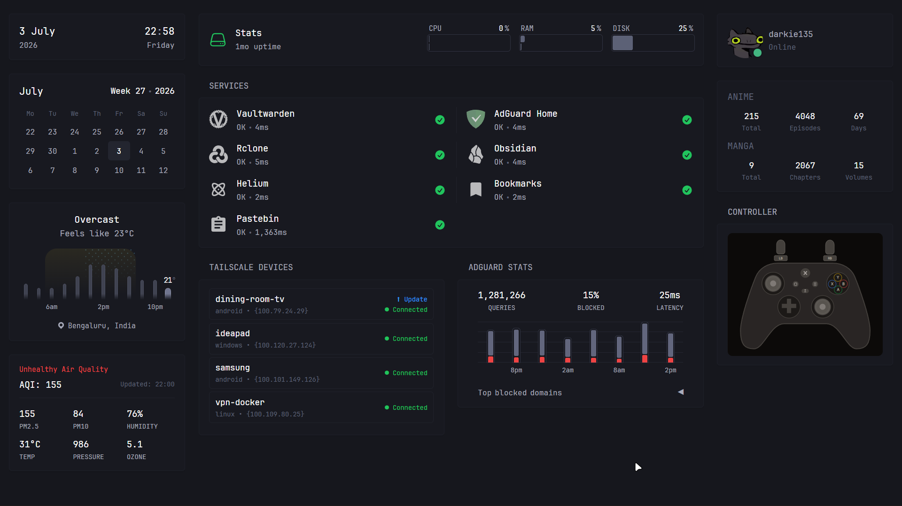

# Glance

Dashboard. First thing that opens. Shows service health, bookmarks, weather, AniList, Discord status, and a bunch of other widgets.

- **URL:** `https://akshad.duckdns.org` (port 443, the default)
- **Image:** `glanceapp/glance`

Config is in `glance.yml`. It hot-reloads on file changes so no restart needed when tweaking widgets.

Health checks use internal Docker network URLs (`http://vaultwarden`, `http://adguardhome`) because Glance runs inside the same Docker network — faster and doesn't depend on Caddy being up. One gotcha: Helium's `/connectivitycheck` endpoint returns 204 which Glance treats as unhealthy. Use `/robots.txt` instead.
