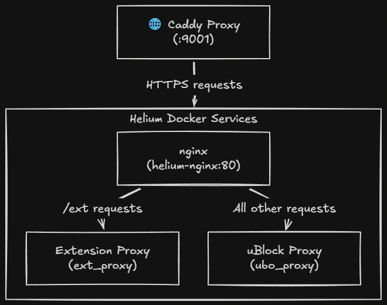

# Helium



Self-hosted backend for the Helium browser extension. Took the most time to get working behind Caddy.

- **URL:** `https://akshad.duckdns.org:9001`
- **Stack:** Multiple containers — `helium-nginx`, `ext_proxy`, `ext_proxy_backup`, `ubo_proxy`

Caddy proxies to `helium-nginx:80`. Helium nginx is a custom build from a Jinja2 template that routes internally to the extension proxy and uBlock proxy.

---

## The nginx Fix

`nginx.conf.j2` had `proxy_pass http://exts;` for the `/ext` location — no trailing slash. This forwarded the `/ext` path to the backend instead of stripping it, causing 404s on every extension download.

Fixed: `proxy_pass http://exts/;`

After any change to the nginx config, rebuild:
```bash
docker compose build helium-nginx
docker compose up -d helium-nginx
```

---

## Glance Health Check

Use `/robots.txt`, not `/connectivitycheck`:
```yaml
check-url: http://helium-nginx/robots.txt
```
`/connectivitycheck` returns 204, which Glance shows as a warning. `/robots.txt` returns 200.
